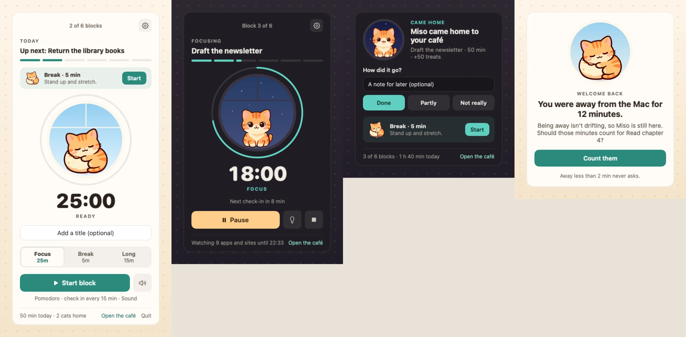
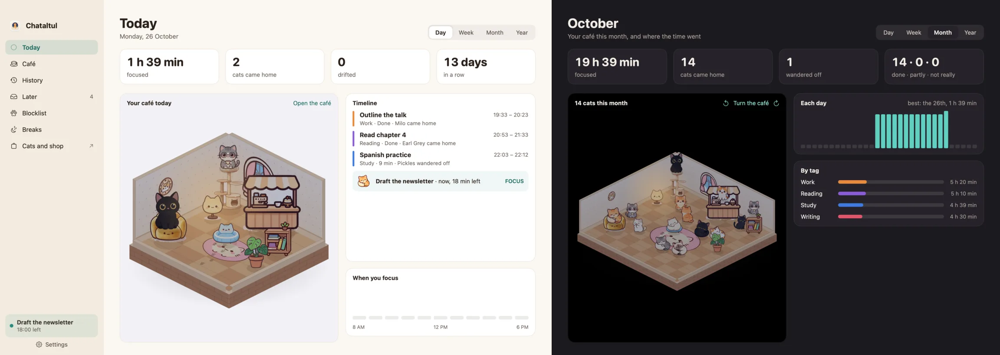
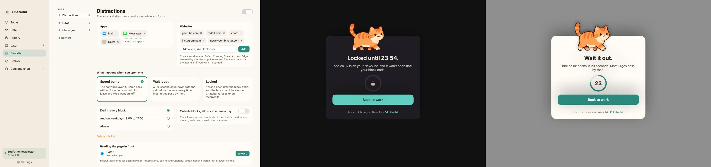
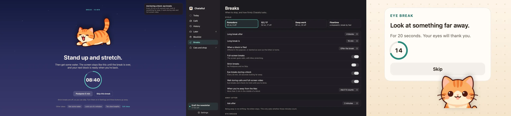
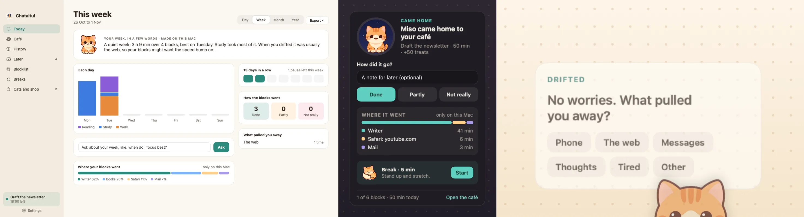
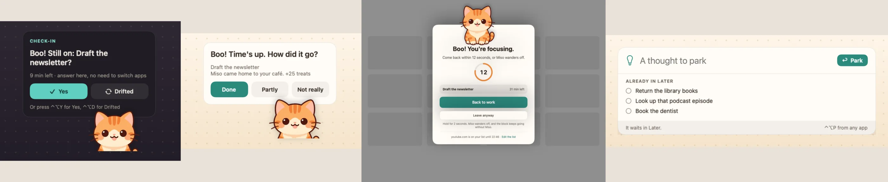
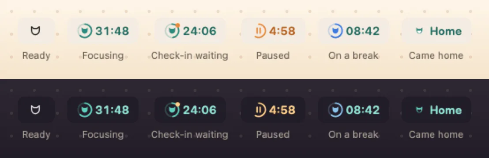
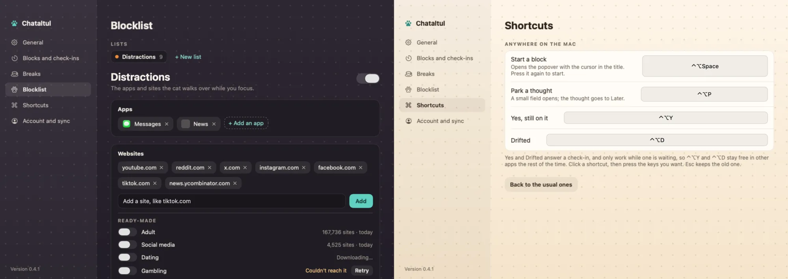

# Chataltul apps

These are the native apps for Chataltul (חתלתול, Hebrew for kitten), my focus app. It used to be called Kavana, which is why the repos and the web address still say kavana. The web version lives at https://stuffs.tiresia.xyz/kavana/ (code in franz-rosenzweig/kavana), and this repo is the native side of it: Android, and now the Mac.

## Android (android/)


**Install it:** download the APK from the newest release on the [Releases page](https://github.com/franz-rosenzweig/kavana-apps/releases/latest) on your phone and open it (Android 12 or newer). The first time, Android asks you to allow installs from that source, which is normal for apps that don't come from the Play Store. If you'd rather get updates by themselves, add `https://github.com/franz-rosenzweig/kavana-apps` to Obtainium.

Chataltul for Android is a REAL native app, written in Kotlin with Jetpack Compose, which means it looks and feels like an Android app and not like a web page in a frame. The one thing it borrows from the web is the engine: the web app's own `engine.js` runs inside the phone's JavaScript sandbox (the one that comes with Android System WebView). This way the kittens, the treats and the missions follow exactly the same rules on the phone and on the web, instead of two copies that slowly drift apart.

What it does:
- **It looks like the web now, and like Forest.** The Focus screen is one screen: the café wall in the background, a round window with the cat who's coming on its cushion, and a ring around the window that you drag for 5 to 120 minutes. Tap the big clock for This Block (tag, timer or stopwatch, how long, check-ins, a first step), then Start. There's no tab bar anymore: the menu at the top left has everything else.
- **During a block** the screen dives into the window and becomes a sky that goes from afternoon to sunset to stars as the block goes on (in dark mode it's a calm night sky the whole way, with a few stars from the start). **At the end** today's café comes up and your cat drops into it with its treats, and **Again** starts the same block in one tap. If your kitten wanders off while you watch, it tiptoes out of the ring.
- Pick how long and press Start, that's it. A title and a tag are there if you want them, like Forest's ("Add a title" under the tag), but you don't need either: a block without a title goes by its tag, or just "Focus". How long can be 5, 25, 50 or your own number of minutes, or a stopwatch that counts up (up to 3 hours; after 10 minutes your kitten can come home). "Ask me" or "Nudge me", the same as the web. Changed your mind? Cancel in the first 10 seconds and nothing counts.
- **Living cats.** The painted cats breathe, blink, flick an ear, swish a tail and tilt their head. Tap one and it hops; hold it and it purrs (the phone purrs too); it follows your finger. No new art: every picture has a rig (`assets/rig.json`, the same one the web uses) and is bent live with `Canvas.drawBitmapMesh`, with the motion numbers from `motion/warp.js`.
- A kitten grows in the ring while you focus, popping from napping to kitten to grown, and comes home to your Café at the end. Stop early, or leave Chataltul in the middle, and it wanders off. Locking the phone is fine. A pause lasts 5 minutes at most (or turn pausing off), and "Count extra time" keeps a block going past its end until you tap Done.
- **The cat over other apps.** If you leave Chataltul in the middle of a block, the cat pops up over whatever app you went to and says "Boo! You're focusing.", counting down the 15 seconds you have to come back before your kitten wanders off. "Back to work" takes you back. "Leave anyway" has to be held for two seconds, and then your kitten wanders off right away (the block keeps going without it). On purpose there's no easy way out: no close button and no pause on the cat. Check-ins that come while you're in another app show up the same way, with Yes and Drifted right on the cat. Android calls this "Display over other apps", and the app asks for it on the first run.
- **Cats, like Forest's collection.** Every cat in colour: the ones you've met are awake, the ones you haven't are asleep with how close you are, the ones in the shop show their price. Tap one to see it big and its three stages.
- **Missions and rewards.** Three missions a day and one a week, a starter challenge, a monthly focus challenge and 27 achievements, each with treats to collect.
- **The shop.** Things for your café, cats to adopt, café themes, sounds, shelter cats you sponsor (each stands for a real shelter cat), and Halloween and winter things in their week.
- **The Café, in 3D.** A floating room you can spin with your finger (the same one as on the web, drawn on the phone), with what you bought and the cats that came home walking, washing and napping in it; your focus by day, week, month or year compared with the one before, when in the day you focus, who came home, and every block, which you can edit (what it was, its tag, a note). "Someday" shows what the café becomes.
- A mindful minute: box breathing with your cat breathing along.
- **Real sounds to focus to.** 39 of them in seven groups (cats purring, rain and water, fire, outside, places, music and noise), the same ones the web plays, with one free in each group and the others in the shop. All but brown and white noise are real recordings (CC0, from Freesound; who recorded each one is in the web repo's [docs/sounds.md](https://github.com/franz-rosenzweig/kavana/blob/master/docs/sounds.md)). Like on the web, a recording downloads the first time you pick it (a megabyte or two) and stays on the phone, so after that it plays offline too. While it downloads, a version made on the phone fills in and the recording fades in when it's ready; the music just starts a moment later. Two can play at once. And a kitten that comes home says hello with a meow (not when the phone is on silent).
- Check-ins are scheduled on the phone itself, so nothing goes through my server. "Still on: …?" (or "Still focusing?" when the block has no title) has Yes / Drifted right on the notification, and "How did it go?" has Done / Partly / Not really, and a note.
- The countdown (or the stopwatch) sits on the lock screen and in the status bar while a block runs (on Samsung, in the Now Bar).
- Later, a daily goal, a daily reminder, breaks, park a thought, +5 / +10 at the end, your own nudge lines, tags, news.
- **Sign in, if you want, and it syncs with the web.** Settings → Sign In: type your email and Chataltul emails you a 6-digit code, and that's it, no password to remember (if you're new, the code makes your account). A name and a password work too. Your history on the phone comes along into the account, and from then on the phone and the web (and your other devices) have the same blocks, Later, cats and settings: a change goes up a moment after you make it, and what you did elsewhere comes in when you open Chataltul. The account page has your email, a password if you want one, signing out (the account's history leaves the phone, it's safe on the server) and deleting the account (your history stays on the phone).

What it doesn't do yet: the parts of the account that are about other people (friends, napping together, rooms with a code, rankings, the shelter counters). Without an account your history stays on the phone and nothing about you is sent anywhere; the one thing the app fetches is a sound's recording, the first time you pick it.

### Building it

It builds on my Mac over SSH, the same way as Daf and Binah (JDK 17 and `~/android-sdk` there):

```
cd ~/Documents/Claude/Projects/kavana-apps/android
./gradlew assembleDebug                 # Chataltul dev, installs beside the real one
./release.sh                            # Chataltul-<version>.apk, signed with Dvarim's key
adb install -r Chataltul-<version>.apk
```

The engine files and pictures come from the web repo with `tools/sync-web.sh` (it records the commit in `assets/js/WEB_COMMIT`; `KAVANA_REPO=<clone>` syncs from a clone on the Mac), and `node tools/test-bridge.js` runs them the way the phone does, with no Android needed.

## Mac (mac/)



Chataltul for Mac is a native Mac app, written in SwiftUI and AppKit. It keeps me focused while I work on the Mac: a kitten in the menu bar, a timer, check-ins, and a cat that walks over the apps and sites that distract me. Like the Android app it runs the web app's own `engine.js` (here in the Mac's JavaScriptCore) and draws everything itself, so the kittens, the treats and the check-ins follow the same rules on the Mac, the phone and the web. Version 0.1 was the part that keeps me focused, 0.2 added the app window, the full Blocklist and the breaks, and 0.3 adds the reports: where each block went, the week in review, streaks with a pause and export.

What it does:
- **The menu bar item** is the kitten, and while a block runs, a ring that empties with the time next to it. It has a state for ready, focusing, a check-in waiting (an orange dot), paused, on a break and came home.
- **The popover** is one card: the round window with the kitten growing in it, the clock, an optional title, Focus, Break and Long, and Start. While a block runs it has Pause (five minutes at most), park a thought and Stop (inside the first ten seconds it takes the block back instead). When the kitten comes home it asks how it went, with a note, and offers the break.
- **Check-ins are the cat peeking up in the corner of the screen** with Yes and Drifted, on top of whatever I'm doing, without taking the keyboard from it. ⌃⌥Y and ⌃⌥D answer them from anywhere, and only while one is waiting, so those keys are free the rest of the time. If the cat is off, or I don't answer, it's an ordinary notification.
- **The speed bump.** While a block runs and I open an app on my list, or a site on my list in Safari, Chrome, Brave, Arc or Edge, the cat walks over it: "Boo! You're focusing.", 15 seconds to come back, and a big "Back to work" that takes me back to the app I was in. "Leave anyway" has to be held for two seconds, and then the kitten wanders off and the block goes on without it. There is no pause, snooze or close button on it. If I do nothing, the 15 seconds run out and the kitten wanders off the same way. Once it has gone, the cat doesn't come up again for that block.
- **Park a thought** with ⌃⌥P, from any app: a small field opens, and the thought goes to Later and onto the block.
- **Start a block from anywhere** with ⌃⌥Space: it opens the popover with the cursor in the title, and pressing it again starts the block.
- **Away from the Mac.** More than two minutes without a key or a click in the middle of a block (or the Mac asleep or locked that long) asks "count them?" when I'm back. Being away is not drifting, so the kitten stays. "Take them off" needs a small change in the web engine that isn't there yet, so for now that button is hidden and the minutes simply count (`mac/docs/engine-takeoff.md`).
- **Sounds** are the web's own 39, up to two at once. All but brown and white noise are recordings, each downloaded the first time it's picked and kept in the app's folder. The list of sounds is read out of the web repo's `sounds.js` and never typed in here. A kitten that comes home says hello with a meow.
- **Sign in by email code and sync with the web**, the same API as the Android app. "Open the café" opens the web app, which shows the same data once I'm signed in. Without an account nothing leaves the Mac, and where each block went never does, account or not.
- **Settings**: General, Blocks and check-ins, Breaks, Blocklist, Shortcuts, and Account and sync. Open at login is a switch in General.

**Version 0.2:**
- **The app window** (Today, Café, History, Later, Blocklist, Breaks), opened from the popover or the Dock icon that appears with it. Today has Day, Week, Month and Year: what was focused (and how it compares with the period before), cats that came home, drifts or wanderings off, days in a row; the café of that period; the timeline of the day with when I focus most; or each day's bar and the time by tag. Café is the same room, bigger.
- **The café in 3D**, drawn natively from the web's own paintings, laid out by the same table as the web's `cafe3d.js` (what I own, where each thing goes, which cat sits on what, a kitten's paw prints where it wandered off), with the light of the time of day. Drag to turn it in quarter turns, tap a cat for its name. It doesn't have the walking cats or the arrival drop yet.
- **The Blocklist** has lists (a colour each), apps with their icons, sites, and for each list what happens when one is opened: the **speed bump**, **wait it out** (30 seconds with the cat before it opens, every time, but a visit that already waited may stay) or **locked** (it doesn't open until the block ends, the block can't be stopped after its first ten seconds, and Chataltul refuses to quit meanwhile). A list can also be watched outside blocks: on weekdays between two times, or always, with an allowance of minutes a day (and how much of it is used today). When the allowance is used up it stops for the day.
- **Breaks:** a soft full-screen break on every screen, with the cat stretching, an idea from my own list, the time left, Postpone and Skip (or neither, with strict breaks). It starts from the popover, or by itself when a block comes home. The cycle can be Pomodoro, 52 / 17, Deep work or Flowtime (a stopwatch, with a break a fifth as long). **Eye breaks** every 20 minutes of a block are a 20-second card in the corner; they and the check-ins wait while a call is on or the front app is in full screen, and being away from the Mac for 20 seconds counts as one.







**Version 0.3:**
- **Where each block went, app by app.** While a block runs, Chataltul notes which app is in front each second and, in Safari, Chrome, Brave, Arc or Edge, the site's name (never the address or the page). Not while the Mac is idle or the block is paused. When a block comes home the popover shows where it went (the bar and the top three: "Writer 41 min, Safari: youtube.com 6 min, Mail 3 min"), with what's on my lists in orange. The window adds "Where your blocks went" to Today for a day, a week, a month or a year. It's kept in `timing.json` on this Mac, it is not in the doc the sync carries, and a switch in Settings turns it off and a button forgets it all.
- **The week in review.** The popover's chart button, or Today on Week, opens it: a few words about the week made on this Mac (a good, uneven or quiet week, the hours and blocks, the best day, what took most of it, what usually pulled me away and when, and what might help), each day stacked by tag against the goal, how the blocks went, and what pulled me away. When I answer Drifted the cat asks what it was (phone, the web, messages, thoughts, tired, or other), and those answers are the numbers behind it.
- **Ask about your week.** A box under the chart. With Apple Intelligence on (macOS 26 or newer) the model that's already on the Mac answers from the week's numbers; otherwise a few kinds of question (best day, when I focus, how much, what pulled me away, tags, streak) are answered straight from the numbers. Nothing is sent anywhere either way.
- **Streaks with a pause.** One missed day a week doesn't break the streak: the week's pause carries it over (weeks start on Monday). The paused day doesn't add to the count, and two missed days in a row still end it. Today shows "5 days in a row · 1 pause left", the week shows which day used it. The web's own streak has no pause, so the two can differ.
- **Export** from Today: the blocks as a spreadsheet (CSV), where the time went as a spreadsheet, and the review in words as Markdown.
- **Focus on the Mac.** Settings has two boxes for the names of Shortcuts to run when a block starts and when it ends. Chataltul can't set a Focus itself, but a Shortcut with "Set Focus" can. I haven't tried Slack's status: that needs a token kept somewhere, and I'd rather not until the rest has been used for a while.









These pictures are the app's own windows, drawn by the self-test from the real views and the real engine.

What it doesn't do yet: the week in review is for one week at a time (no comparison with the week before beyond Month and Year's "+6 h"), the drift reasons are only as good as the taps, and Slack's status isn't there. "Locked" is as strong as an app can make it: it can't be stopped or quit from Chataltul, and it picks up again after a restart, but Force Quit or logging out still ends it, and nothing relaunches the app. A stronger lock needs a helper with more rights than a normal app, which I haven't built. Breaks of 17 or 20 minutes (52 / 17, Deep work) and Flowtime's by-feel breaks are longer than the engine's 5, 10 and 15, so the Mac keeps their end itself; `mac/docs/engine-takeoff.md` asks for the web engine to allow them. The painted cats are still pictures that breathe a little on the cat's cards; they don't blink or swish their tails yet, which needs the living-cat rig and comes later. "Napping together" and friends are not here either, as on Android.

**What it asks for.** Only two things, and only when it needs them. Notifications, the first time a block starts. And, the first time a browser is in front during a block (with sites on my list, or with "where each block went" on), my OK to read the address of its front tab: macOS asks once for each browser (Automation), and the cat says plainly what it is about to ask first. It only ever notes the site's name. If I say no, Chataltul just doesn't watch that browser and carries on with the app list. Firefox and Zen can't be read this way, so their sites aren't watched; I can list the Firefox or Zen app itself instead.

### Building it

```
cd mac
./build.sh && open build/Chataltul.app        # builds with the Command Line Tools, signed with a development identity if there is one
```

It needs macOS 14 or newer, Xcode's command line tools and `brew install xcodegen`. `project.yml` is the XcodeGen spec for Xcode, and `build.sh` reads the same settings. The engine files, the paintings and the sound list come from the web repo with `mac/tools/sync-web.sh` (it records the commit in `Resources/js/WEB_COMMIT`): never edit the copies. `mac/selftest.sh` tests everything without me at the keyboard: `core` (the engine, its pings, the cat names in them, the away op, the speed bump's, wait it out's and the lock's rules, the schedules and allowances, the breaks and the numbers in Today, the sound list), `ui` (every screen drawn to a PNG, and the real app wired up with its windows far off the screen), `sync` (signing in and syncing against a sandbox copy of the web server on this Mac, never the real one), and `launch`. More in [mac/README.md](mac/README.md).

## Living cats (motion/)

The motion study and its tools: `warp.js` (the web's living cats, a copy of what's in the web app), `rig.json` (every picture's eyes, head, neck, ears, tail and ground line), `tools/eyes.js` and `tools/rig.js` (find them in new pictures, with hand fixes for what the finder misses) and `tools/folds.js` (checks no motion folds a picture over).

The account check, `tools/check-account.py`, signs in and syncs on the emulator against a sandbox copy of the server on this computer (never the real one: it makes and deletes accounts, so it refuses any other address). It reads the emailed codes from the sandbox's outbox, plays a second device through the API, and walks signing in by email, syncing both ways, a password, signing out and back in, a password changed elsewhere, and deleting the account. How to start the sandbox is at the top of the script.

The device check, `tools/check.py`, drives a phone plugged into my Mac over SSH (or an emulator, with `KAVANA_ADB`). It needs to know which Mac: `KAVANA_MAC=user@host`, plus `KAVANA_MAC_KEY` if ssh needs a key, or the same two lines in `~/.config/kavana-apps/mac.env`, which stays out of the repo. It stops and says so if neither is there.

The debug build can speed its clock up for testing: `adb shell am start -n xyz.tiresia.kavana.debug/xyz.tiresia.kavana.MainActivity --el minute 1000` makes a minute last one second (force-stop it first).

## iPad (PLAN-ipad.md)

The iPad app is only a plan for now. Apple doesn't let the free developer account use Screen Time, so it waits on the paid Developer Program. The plans for both are in `PLAN-android.md` and `PLAN-ipad.md`.
