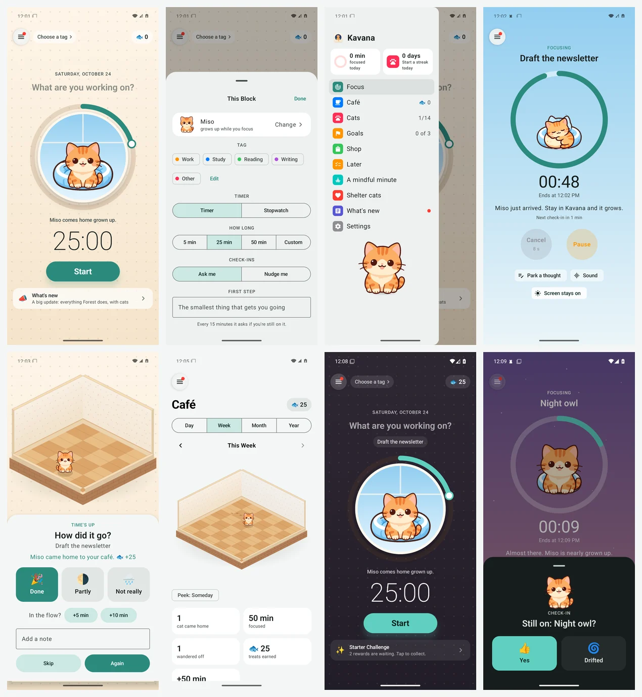

# Kavana apps

These are the native apps for Kavana, my focus app. The web version lives at https://stuffs.tiresia.xyz/kavana/ (code in franz-rosenzweig/kavana), and this repo is the phone side of it.

## Android (android/)



**Install it:** download the APK from the newest release on the [Releases page](https://github.com/franz-rosenzweig/kavana-apps/releases/latest) on your phone and open it (Android 12 or newer). The first time, Android asks you to allow installs from that source, which is normal for apps that don't come from the Play Store. If you'd rather get updates by themselves, add `https://github.com/franz-rosenzweig/kavana-apps` to Obtainium.

Kavana for Android is a REAL native app, written in Kotlin with Jetpack Compose, which means it looks and feels like an Android app and not like a web page in a frame. The one thing it borrows from the web is the engine: the web app's own `engine.js` runs inside the phone's JavaScript sandbox (the one that comes with Android System WebView). This way the kittens, the treats and the missions follow exactly the same rules on the phone and on the web, instead of two copies that slowly drift apart.

What it does:
- **It looks like the web now, and like Forest.** The Focus screen is one screen: the café wall in the background, a round window with the cat who's coming on its cushion, and a ring around the window that you drag for 5 to 120 minutes. Tap the big clock for This Block (tag, timer or stopwatch, how long, check-ins, a first step), then Start. There's no tab bar anymore: the menu at the top left has everything else.
- **During a block** the screen dives into the window and becomes a sky that goes from afternoon to sunset to stars as the block goes on. **At the end** today's café comes up and your cat drops into it with its treats, and **Again** starts the same block in one tap. If your kitten wanders off while you watch, it tiptoes out of the ring.
- You say what you're working on, pick a tag, and pick 5, 25, 50 or your own number of minutes, or a stopwatch that counts up (up to 3 hours; after 10 minutes your kitten can come home). "Ask me" or "Nudge me", the same as the web. Changed your mind? Cancel in the first 10 seconds and nothing counts.
- **Living cats.** The painted cats breathe, blink, flick an ear, swish a tail and tilt their head. Tap one and it hops; hold it and it purrs (the phone purrs too); it follows your finger. No new art: every picture has a rig (`assets/rig.json`, the same one the web uses) and is bent live with `Canvas.drawBitmapMesh`, with the motion numbers from `motion/warp.js`.
- A kitten grows in the ring while you focus, popping from napping to kitten to grown, and comes home to your Café at the end. Stop early, or leave Kavana in the middle, and it wanders off. Locking the phone is fine. A pause lasts 5 minutes at most (or turn pausing off), and "Count extra time" keeps a block going past its end until you tap Done.
- **The cat over other apps.** If you leave Kavana in the middle of a block, the cat pops up over whatever app you went to and says "Boo! It's time to focus.", with "Back to work" and "Let me in". Check-ins that come while you're in another app show up the same way, with Yes and Drifted right on the cat. Android calls this "Display over other apps", and the app asks for it on the first run.
- **Cats, like Forest's collection.** Every cat in colour: the ones you've met are awake, the ones you haven't are asleep with how close you are, the ones in the shop show their price. Tap one to see it big and its three stages.
- **Missions and rewards.** Three missions a day and one a week, a starter challenge, a monthly focus challenge and 27 achievements, each with treats to collect.
- **The shop.** Things for your café, cats to adopt, café themes, sounds, shelter cats you sponsor (each stands for a real shelter cat), and Halloween and winter things in their week.
- **The Café, in 3D.** A floating room you can spin with your finger (the same one as on the web, drawn on the phone), with what you bought and the cats that came home walking, washing and napping in it; your focus by day, week, month or year compared with the one before, when in the day you focus, who came home, and every block, which you can edit (what it was, its tag, a note). "Someday" shows what the café becomes.
- A mindful minute: box breathing with your cat breathing along.
- Check-ins are scheduled on the phone itself, so nothing goes through my server. "Still on: …?" has Yes / Drifted right on the notification, and "How did it go?" has Done / Partly / Not really, and a note.
- The countdown (or the stopwatch) sits on the lock screen and in the status bar while a block runs (on Samsung, in the Now Bar).
- Later, a daily goal, a daily reminder, breaks, park a thought, +5 / +10 at the end, your own nudge lines, tags, news.

What it doesn't do yet: accounts and sync, so nothing that needs them either (friends, napping together, rooms with a code, rankings, the shelter counters). Everything stays on the phone.

### Building it

It builds on my Mac over SSH, the same way as Daf and Binah (JDK 17 and `~/android-sdk` there):

```
cd ~/Documents/Claude/Projects/kavana-apps/android
./gradlew assembleDebug                 # Kavana dev, installs beside the real one
./release.sh                            # Kavana-<version>.apk, signed with Dvarim's key
adb install -r Kavana-<version>.apk
```

The engine files and pictures come from the web repo with `tools/sync-web.sh` (it records the commit in `assets/js/WEB_COMMIT`; `KAVANA_REPO=<clone>` syncs from a clone on the Mac), and `node tools/test-bridge.js` runs them the way the phone does, with no Android needed.

## Living cats (motion/)

The motion study and its tools: `warp.js` (the web's living cats, a copy of what's in the web app), `rig.json` (every picture's eyes, head, neck, ears, tail and ground line), `tools/eyes.js` and `tools/rig.js` (find them in new pictures, with hand fixes for what the finder misses) and `tools/folds.js` (checks no motion folds a picture over).

The device check, `tools/check.py`, drives a phone plugged into my Mac over SSH (or an emulator, with `KAVANA_ADB`). It needs to know which Mac: `KAVANA_MAC=user@host`, plus `KAVANA_MAC_KEY` if ssh needs a key, or the same two lines in `~/.config/kavana-apps/mac.env`, which stays out of the repo. It stops and says so if neither is there.

The debug build can speed its clock up for testing: `adb shell am start -n xyz.tiresia.kavana.debug/xyz.tiresia.kavana.MainActivity --el minute 1000` makes a minute last one second (force-stop it first).

## iPad (PLAN-ipad.md)

The iPad app is only a plan for now. Apple doesn't let the free developer account use Screen Time, so it waits on the paid Developer Program. The plans for both are in `PLAN-android.md` and `PLAN-ipad.md`.
